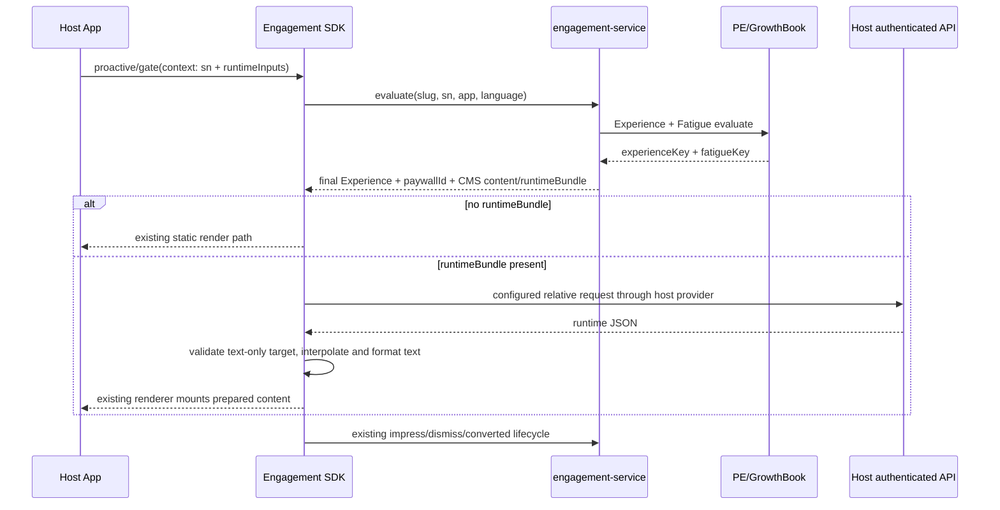

# Engagement 动态文案 runtime 接入与审查

本文用于 CMS 文案包含 `{{variable}}`、`runtimeText` 或 `runtimeBundle` 的 App 触点。历史三端实现可追溯到 engagement SDK MR `!817`，但历史实现不是架构规范；本契约明确禁止其中由动态 creative 决定 Paywall 的做法。能力是否可用以目标 App 实际固定的 SDK revision 为准，不以 MR 链接、源分支或本地 checkout 代替依赖证据。

## 1. 三条不可混淆的链路

| 链路 | 决定什么 | 权威位置 |
|---|---|---|
| Experience / 业务准入与路由 | 这个用户/设备是否命中触点，以及最终 Banner 样式、CTA 和 Paywall | PE 属性 + GrowthBook Experience + admin snapshot + engagement-service evaluate |
| Fatigue | 曝光上限、曝光冷却、dismiss 冷却、永久抑制 | GrowthBook Fatigue + admin fatigue variant + engagement-service impress/dismiss/evaluate |
| Dynamic copy | 对已选定 CMS 模板执行变量替换、单复数、数字/日期/相对时间等展示格式化，并校验内容完整性 | CMS `runtimeBundle` + 宿主 `runtimeInputs`/鉴权网络 + SDK resolver/formatter |

evaluate 已通过 Experience/Fatigue 并返回最终 Experience、Banner、CMS 模板和 `paywallId` 后，SDK 可为模板准备变量并完成通用文案处理，包括条件式的语法和本地化分支。业务准入、疲劳度、业务变体和路由仍由平台决定；缺值或类型错误通过统一 `failureBehavior` 处理。

不可变决策链：

```text
PE attributes -> GrowthBook variantKey -> Admin Experience(cmsSlug + actionConfig.paywallId)
              -> engagement-service final TouchpointView -> SDK render + standard events
```

一个 Experience 必须唯一确定内容样式和 action。Snapshot、Rolling 等场景如果 Banner 或 Paywall 不同，必须是不同的 GB/Admin Experience；不得先命中通用 treatment，再让 SDK 用 N/D、`creativeKey` 或 `paywallIdsByCreative` 二次分流。

### 展示格式化与业务变体的判别

| 例子 | 归属与判断 |
|---|---|
| `N=1` 显示 `1 video`，`N=2` 显示 `2 videos`，`N=0` 显示 `No videos` | 允许：同一业务含义的语法分支，CMS 配模板，SDK 通用 formatter 处理 |
| 数字分组、日期格式、同一到期时间显示 `today` / `tomorrow` | 允许：按 locale、明确时区和时间基准格式化同一事实，不切换营销方案 |
| 按 N/D 改为 Snapshot/Rolling、不同卖点/优惠/套餐话术 | 业务变体选择，必须由 PE/GB/Admin/service 决定；即使只写 `text` 且 Paywall 相同也不能由 runtime 分流 |
| 按 N/D 修改 `preset`、`creativeKey`、CTA 或 `paywallId` | 禁止：覆盖服务端最终样式或路由 |
| 将有效的 `N=0` 当作缺值，隐藏整个触点 | 禁止用格式化代替业务准入；需要此条件时进入 PE/GB |

`runtimeText.cases` 或其他条件语法本身不是违规证据，要追踪条件输入和输出的实际含义。允许的分支只处理同一模板的语法、数值或日期表达；不得承担会员、权益、业务方案或实验分组决策。`visibleWhen`/内容完整性校验只能表达值缺失、类型错误等渲染有效性，不扩展为业务展示判断。

## 2. 职责边界

| 系统 | 应负责 | 不应负责 |
|---|---|---|
| 宿主 App | 传 `sn`和显式 `runtimeInputs`；用已有鉴权网络实现 SDK runtime data provider；页面/账号/语言变化时失效旧请求；挂载容器并执行 service 已确定的 CTA | 本地会员准入、GB 规则、Session/Day 计数、dismiss cooldown、根据 runtime 值选择 creative/Paywall、自报第二套通用曝光 |
| CMS | 定义变量、数据源、参数绑定、JSON 路径、类型、文本格式化规则、仅限文案字段的 `allowedTargets` 和超时 | 保存鉴权凭据、绝对域名、不受控的任意网络目标、疲劳度状态，或让 runtime 选择营销业务变体、修改 `preset`/action/Paywall |
| SDK | 冻结输入快照；按 CMS 配置读 context/API；同源请求去重；超时/失效检查；类型校验；在允许文本字段执行替换、单复数等格式化；可沿现有架构扩展 resolver/formatter/builder | 硬编码 Library 业务数据口径、猜测全局 App 状态、解释会员资格、本地疲劳度、选择营销方案/creative/preset、改写 action 或 `paywallId` |
| PE/GB/Admin/Service | 用权威属性决定 Experience 和 Fatigue；Admin Experience 唯一绑定 CMS 内容、Banner 样式和 action；service 返回最终 `paywallId` | 为每个文案占位符定制客户端逻辑，或把最终路由留给客户端决定 |

`EngagementContext.presentation.shouldPresent` 不是 impressed/converted 一类触点事件，而是允许宿主否决 service 结果的第二决策源。新触点和 SDK 基础能力不得引入或使用这个回调。页面销毁、容器换世代和异步结果过期应由订阅取消、生命周期 token 和挂载有效性在集成层内部处理，不向业务方开放展示判断。evaluate 已通过 Experience/Fatigue、动态内容也按 CMS 规则完成解析时，宿主直接展示。

通用文案解析、格式化和渲染可以在 SDK 实现，不要求宿主重复实现。需要新增能力时按 `sdk-core-change-guardrails.md` 分级评审；若同时改动 evaluate/network/cache/lifecycle，再补这些公共 surface 的兼容性证据。与业务同 MR、只有首个消费者，不单独构成阻断。

## 3. 能力启用门槛

配置 CMS 动态文案前，必须有以下证据：

1. 目标 Android/iOS/Flutter App 的锁定 SDK revision 已包含 runtime resolver，而不是只在未合入 MR 或其他分支存在。
2. 目标端的既有触点入口能把 `EngagementContext.runtimeInputs` 传到 evaluate/runtime 准备链路。
3. 宿主网络 provider 支持 CMS 配置的 `service + method + relative path`，复用当前账号鉴权、区域和网关路由。默认 provider 不支持的 service/method 必须在宿主明确实现，不假设 SDK 自动支持。
4. marketing-cms 及其后端允许目标数据源、字段和 `allowedTargets`；不只看 App 代码。
5. 静态触点的回归证明：无 `runtimeBundle` 时不发 runtime 业务请求，不改变原有缓存和埋点语义。
6. 每个 GB `variantKey` 在 Admin 中唯一绑定 `cmsSlug`/Banner 样式和 action；动态变量的 `allowedTargets` 不包含任何样式、身份或路由控制字段。

### 当前能力范围

- 只有 CMS content 存在有效 `runtimeBundle` 时才进入运行时准备。
- 静态触点继续使用原有 evaluate/render 路径；不要要求老业务为了动态能力全量改调新方法。个别 SDK 内部可以用 `evaluateWithRuntime` 复用实现，但对静态内容必须是无额外 runtime network 的快速分支。
- 已解锁 `FEATURE_GATE` 的宿主 child 不应进入动态 CMS 准备。
- 直接 Paywall 的 runtime 由对应 Flutter/H5 Paywall 数据链路处理；不要仅因 action 是 `OPEN_PAYWALL` 就把 Banner 动态文案 resolver 插入页面 runtime。
- 动态 resolver/formatter 只处理文本类展示字段，可扩展单复数、数字、日期/相对时间和本地化语法。`blockType`、`preset`、`creativeKey`、`cmsSlug`、`actionType`、`actionContext`、`paywallId`、`solutionId` 及其子路径必须拒绝作为变量目标。
- SDK 必须原样使用 engagement-service 下发的最终 action 和 `paywallId`；不存在“resolved creative route”或动态 Paywall 映射。
- 不同端的公开类型和方法名可不同，接入时以目标 SDK revision 为准，不从某一端类名推断另一端。

## 4. 配置与输入卡

```yaml
dynamicCopy:
  sdkRevision: <目标 App 锁定 revision>
  content:
    cmsSlug: <engagement content slug>
    blockType: <SDK 已支持的 blockType>
  runtimeInputs:
    - path: library.query
      source: <页面已有的设备/日期/筛选参数>
      required: true
  dataSources:
    - key: library
      kind: api | context
      service: iot
      method: POST
      path: /library/newselectlibrary/newevent
      parametersFrom: library.query
      responsePath: data.runtimeSummary
      successPath: result
      successValue: 0
      timeoutMs: 4000
  variables:
    - key: todayVideoVisitCount
      valuePath: videoVisitCount
      valueType: integer
      allowedTargets:
        - engagements.inlineBanner.text
  formatting: <记录所需单复数/数字/日期/相对时间规则与 locale、时区；实际语法以 SDK/CMS schema 为准>
  forbiddenTargets:
    - blockType
    - preset
    - creativeKey
    - cmsSlug
    - actionType
    - actionContext
    - paywallId
    - solutionId
  failureBehavior:
    missingInput: suppress_affected_block
    requestFailure: suppress_affected_block
    timeout: suppress_affected_block
    staleResult: discard
  cache:
    resolvedValues: forbidden
    resolvedCopy: forbidden
    serviceAttributionOnly: true
```

字段名是 CMS 契约的一部分，实际支持形状以目标 SDK revision 和 marketing-cms schema 为准。不要把样例中的 Library API、N/D 或 4000ms 复制为所有触点默认值。

### `runtimeInputs` 是什么

`runtimeInputs` 是 JSON object / 字典，不是 evaluate 服务响应的业务结果。它保存当前调用已明确拿到的页面查询参数，例如设备列表、日期和筛选条件。SDK 根据 CMS `parametersFrom` 绑定请求；缺必要输入时应不发未限定请求并收起受影响内容。

### `kind=context` 与 `kind=api`

- `context`：只从显式 `runtimeInputs` 读值，不发网络请求。宿主可以把页面已经权威查到的、最小化且可快照的业务值放入 context；仍不把它用于客户端疲劳度或实验准入。
- `api`：SDK 把 CMS 配置的相对路径和绑定参数交给宿主网络 provider；域名、鉴权、区域和网关前缀仍属于宿主。

同一次准备中多个变量共用完全相同的 data-source key/config 时应只发一次请求。

## 5. 运行时时序



通用 `touchpoint_evaluated/impressed/cta_clicked/dismissed/converted` 的事件名、字段和触发语义不因动态文案改变。业务自定义的 500ms 曝光可作为额外 observer，不得替代 SDK impressed 或用来推进 Engagement fatigue。

## 6. 缓存与失效

- 请求开始时冻结 `runtimeInputs`，避免异步过程中参数被宿主修改。
- 账号、语言、页面或绑定世代变化后，旧结果不得挂载。
- 快照缓存不保存用户 runtime values、已替换文案或业务 API 响应。
- attribution、Experience 和 `paywallId` 只能来自 service 返回的 `TouchpointView`；缓存可以保留这份服务端元数据，但动态 resolver 不生成、选择或覆盖任何 route。
- 动态内容不使用包含旧 resolved copy 的乐观快照；缺值/失败不回退上一账号或上一语言文案。

## 7. Review 阻断项

以下任一项视为阻断级：

- 新增、暴露或调用 `shouldPresent` 一类宿主展示否决回调；或用 `runtimeText`、`runtimeValues`、Controller/Widget/App 本地 policy 重做会员准入、实验或疲劳度。
- 在 SDK 通用层硬编码业务 endpoint、N/D 算法、Library 变量字典或特定触点 policy。
- CMS 可以配置绝对 URL、任意 service/path，或绕过现有 CMS/SDK/provider 白名单。
- 缺少必要 `runtimeInputs` 时仍发送无设备/无日期/无账号范围的请求。
- 把 resolved copy、runtime values 或鉴权 API 原始响应写入全局快照缓存。
- 无 `runtimeBundle` 的静态触点也调用 runtime 业务 API，或动态改造改变静态缓存/通用事件语义。
- 动态取值失败后展示未解析占位符或旧账号值。
- 把语法/格式分支用于不同营销卖点、优惠、套餐或业务方案选择，即使输出只落在文案字段；或把合法零值伪装成渲染失败来隐藏触点。
- `allowedTargets` 包含 `blockType`、`preset`、`creativeKey`、`cmsSlug`、`actionType`、`actionContext`、`paywallId`、`solutionId` 等控制字段。
- App/SDK/runtime 内容使用 `creativeKey`、`paywallIdsByCreative`、N/D 或其他业务值二次选择 Banner 样式、CTA 或 Paywall。
- 一个 GB/Admin Experience 对应多个 Banner/Paywall，导致标准事件的 `experience_key` 无法唯一解释最终展示和路由。
- 目标 App 尚未固定包含能力的 SDK revision，却已发布只能由新 resolver 解释的 CMS 内容。

## 8. 最低测试与验收

| 类型 | 必测行为 |
|---|---|
| 静态回归 | 无 `runtimeBundle` 时 runtime provider 0 请求；原 renderer、cache 和事件次数不变 |
| context source | 从冻结 `runtimeInputs` 取值，不发网络；缺输入 fail-closed |
| API source | 精确校验 service/method/path/绑定参数/鉴权；多变量同源只发一次请求 |
| 解析 | 类型、JSON path、占位符替换、未知变量和非法 target 失败策略三端一致；控制字段及子路径全部被拒绝 |
| 格式化 | 验证 0/1/多数量的语法、locale、数字/日期格式、时区/跨日的相对时间；同一业务含义且不改变 Experience/preset/action/paywallId/疲劳度/标准事件 |
| 可靠性 | timeout、网络失败、业务错误、页面/账号/语言失效后不挂载旧结果 |
| 缓存/路由 | 缓存不含 runtime values/resolved copy；动态解析前后 state/CTA 始终使用 service 下发的同一 `paywallId` |
| 投放/疲劳 | evaluate 已先过滤 targeting/cooldown/permanent/max impressions；宿主没有展示否决回调、第二套计数或冷却 |
| 事件 | 通用 evaluated/impressed/cta/dismissed/converted 每次生命周期只发一次；观察事件不返回展示决策，也不改变展示结果 |
| 归因 | 每个 `experience_key` 唯一对应 CMS Banner 与 `paywall_id`；N/D 变化不改变二者 |
| 实机 | 锁定 App + SDK revision + CMS/admin/GB snapshot，验证动态文案、服务端确定的 CTA、页面离开和账号切换 |

上线前记录 runtime 数据请求的请求率、成功/失败/超时率和 P95/P99 延迟，并分别测量静态与动态触点从 evaluate 到可见内容的耗时。

## 9. 排障索引

| 现象 | 先查 |
|---|---|
| evaluate 无触点 | Experience/PE/GB/admin snapshot/Fatigue，不是 runtime copy |
| evaluate 有 `runtimeBundle`，但 runtime API 没请求 | 目标 SDK revision、入口是否进 resolver、缺 `runtimeInputs`、provider service/method 是否支持 |
| runtime API 成功但 block 被收起 | `successPath/value`、`responsePath`、`valuePath`、类型、`allowedTargets`、`runtimeText` 条件 |
| 单复数或 `today`/`tomorrow` 不正确 | 查 CMS 格式规则、locale、时区和时间基准；这是 SDK formatter 排障，不据此删除所有文案分支 |
| 出现 `{{...}}` | malformed bundle 被当静态内容、目标未允许、解析失败后错误回退 |
| 切换账号/语言后仍显示旧值 | epoch/cache 失效、resolved copy 被全局缓存 |
| N/D 变化后 Banner/Paywall 变化 | 实现越界：删除客户端 creative/route 分流，把条件移到 PE/GB 并拆成唯一 Experience |
| CTA 打开结果与 service `paywallId` 不同 | SDK/宿主非法覆盖 action；删除 `paywallIdsByCreative` 等映射并恢复服务端最终路由 |
| service 判定 show 但 App 隐藏 | 查宿主展示否决回调或本地 eligibility/frequency policy；删除第二决策源，规则移回 PE/GB/Fatigue |
